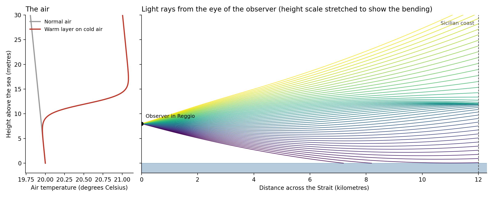
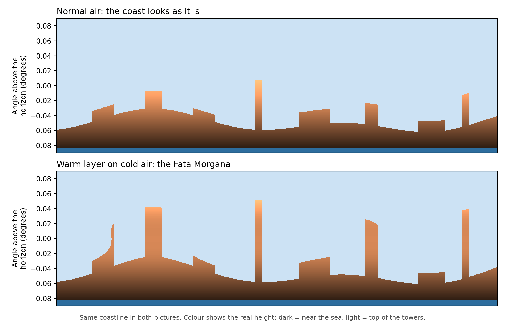
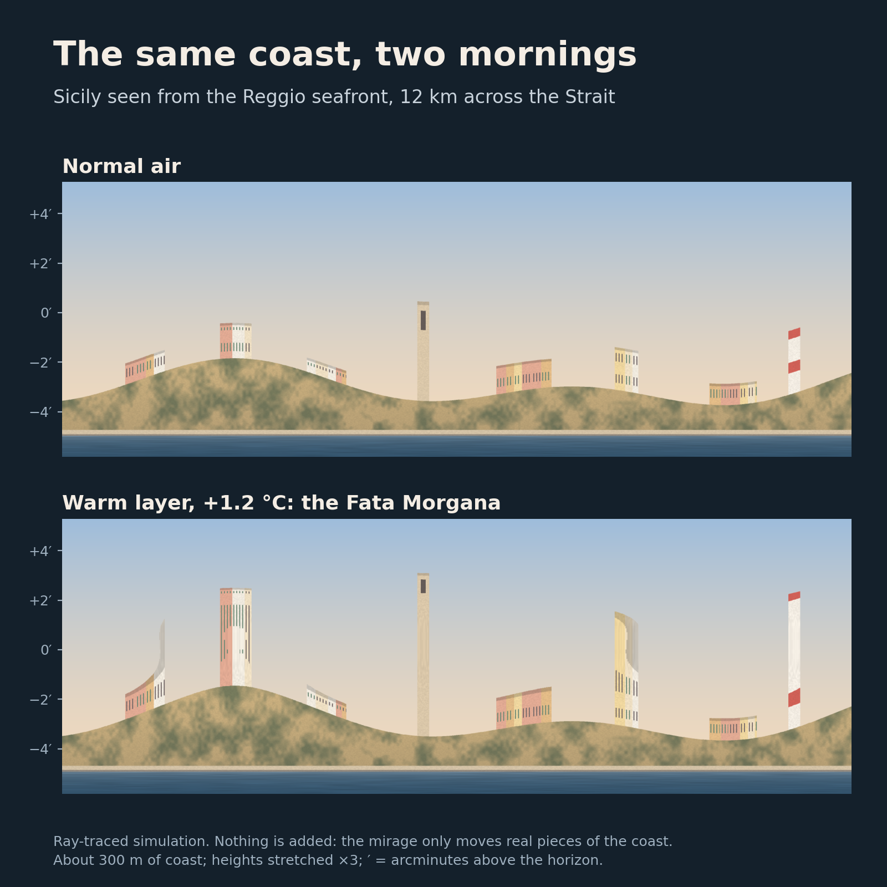
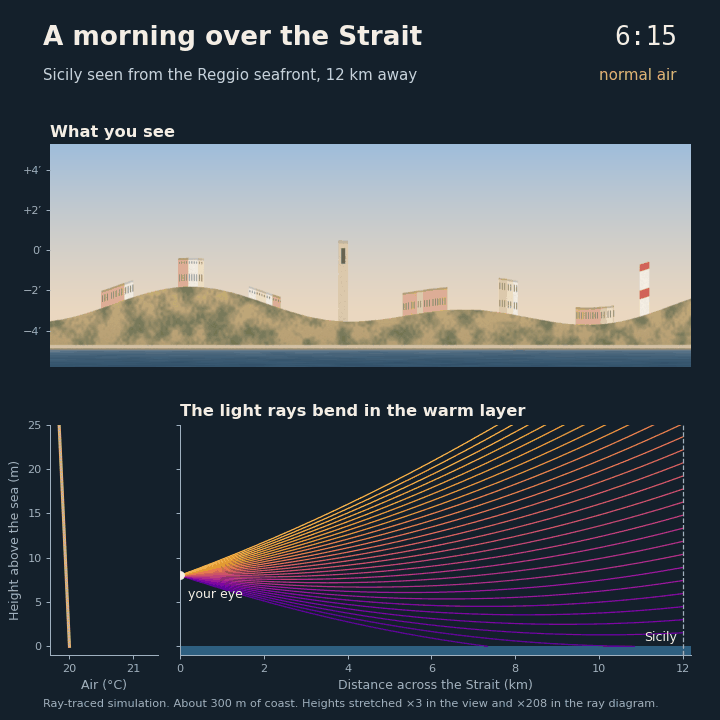

## A city in the sky

Summer, early morning, the seafront of Reggio Calabria. The sea is flat like glass. The old men are already at the railing. On the other side of the water, Sicily begins to move. The coast lifts off the sea. The houses stretch up into towers. A white city stands in the air, close enough to touch.

Nobody shouts. People in Reggio have seen it many times. They just look.

A few minutes later, the air moves, and the city is gone.

People here call it the Fata Morgana, and Reggio is sometimes called the City of the Fata Morgana. I grew up with this story. In this article I want to tell you where the name comes from, what really happens in the air, and why I found the same mirage, many years later, inside artificial intelligence.

## The fairy and the king

The Normans brought the stories of King Arthur to the south of Italy in the eleventh century. With them came his magic sister, Morgan le Fay. Here she became the Fata Morgana, the fairy Morgana.

The legend has many versions. In one of them, a foreign king arrives in Reggio and sees Sicily on the horizon. He wants it, but he has no boat. The fairy appears and makes the island look just a few steps away. The king steps into the water to walk across.

And the sea takes him.

He did not die because the island looked strange. He died because it looked close, and real, and exactly like what he wanted.

## Light that bends

The Fata Morgana is not magic. It is light that bends.

After a cool night, the air just above the sea stays cold. The sun warms the air higher up. Now warm air sits on top of cold air, and the morning is so calm that the two layers do not mix.

Light travels a little slower in cold air. So the light from the Sicilian coast does not go straight. It curves. Our eyes do not know this. They put the image in the wrong place: higher, taller, stretched.

In 1773, a friar from Calabria called Antonio Minasi watched it again and again from these shores. He showed that the floating palaces were real buildings and real coastline, moved to the wrong place in the sky.

Nothing is invented. Real pieces, put together in the wrong way, and the result is completely believable.

## The mirage on my computer

I wanted to see it again, so I wrote a short Python program that recreates the Fata Morgana. It uses only NumPy and Matplotlib and runs on any laptop in a few seconds.

You stand on the seafront, with your eyes 8 metres above the sea, and you look at a coast 12 kilometres away. The program:

1. **Describes the air.** On a Fata Morgana morning, the air gets about 1.2 degrees warmer in a thin layer around 12 metres above the sea.
2. **Follows the light.** It sends hundreds of rays from the eye toward the coast. At every step, each ray bends a little toward the colder air. The Earth is round, and the program takes that into account.
3. **Draws the picture.** For each ray, it checks where it lands: sea, coast or sky.

On the left of the first figure, the red line is the warm layer. On the right, you can see that many rays leaving the eye at different angles arrive at almost the same point on the far coast. This is the whole secret: many directions of your eye all see the same small piece of the coast.

<figure>
  
  <figcaption>Temperature of the air and paths of the light rays across the Strait.</figcaption>
</figure>

The second figure shows the same coastline through normal air and through the warm layer. The colour shows the real height of each piece.

<figure>
  
  <figcaption>The same coastline seen through normal air and through the Fata Morgana.</figcaption>
</figure>

With the warm layer, the houses rise into tall walls. On stronger mornings, some shapes appear twice, once upside down. Nothing was added. The program only moved real pieces of the coast, just as Minasi described.

Then I painted a small village by the sea, with houses, a bell tower and a lighthouse, and sent it through the same rays. Nothing in the second picture was drawn by hand.

<figure>
  
  <figcaption>The same painted coast on a normal morning and on a Fata Morgana morning.</figcaption>
</figure>

And here is a whole morning: the warm layer grows, the coast rises, then the air mixes and the city fades away.

<figure>
  
  <figcaption>A morning over the Strait: the warm layer grows, the coast rises, then the mirage fades.</figcaption>
</figure>

The numbers are chosen to make the effect easy to see. Real mornings are never perfectly calm, so the real mirage trembles. But the point stays: about one degree of difference in the air is enough to put a city in the sky.

You can find the code here: [github.com/Smantii/calabria-meets-ai](https://github.com/Smantii/calabria-meets-ai/tree/master/fata_morgana).

## The fairy inside the machine

Artificial intelligence has its own Fata Morgana. People call it a "hallucination".

You ask a chatbot a question and it gives you a clear, confident answer. It cites a book that does not exist. It quotes a number nobody ever measured. It sounds right, and that is the problem.

A language model learns from a huge amount of text which words usually follow which. When it answers, it builds the most likely sentence, piece by piece. But it has no direct way to check if the sentence is true. It only knows that it looks like a true sentence.

So a hallucination is made like the mirage:

- It is built from real pieces.
- The pieces are put together in the wrong way.
- The result looks believable, often more than the truth.

## Six questions about my city

I asked two small chatbots six questions about the Fata Morgana, and I checked every answer against the original sources.

The models are Gemma 3 (4 billion parameters, by Google) and Llama 3.2 (3 billion parameters, by Meta). They run on a normal laptop with no internet, so everything they say comes from their training. Each question was asked in a fresh chat, with a limit of three sentences. For names and dates, I also asked: "Can you give me the source, with page number?" Here are two of the answers.

**Who wrote the first scientific description?** Antonio Minasi, in 1773. Gemma answered with complete confidence:

> Giovanni Bohler, a Swiss astronomer, published the first detailed scientific description of the Fata Morgana in the Strait of Messina in 1858. His observations, made while aboard the ship *Maria Rosa*, meticulously documented the phenomenon's appearance and behavior.

A name, a nationality, a year, a ship. Asked for the source, it gave a German title, a publisher and "pages 151-155 of the first edition". I could find none of it.

**The trap.** What did Minasi and Goethe say when they watched the Fata Morgana together? As far as we know, they never did. Llama said it had no information, which is right. Gemma wrote:

> Antonio Minasi and Goethe famously exclaimed, "A wondrous thing!" upon witnessing the Fata Morgana phenomenon in 1786. [...] It remains a celebrated anecdote illustrating the power of shared awe and observation.

In 1786 Goethe had just arrived in Italy. He reached Sicily the next spring. The anecdote is celebrated nowhere, because it never happened.

**Two ways to fail.** Gemma almost never said "I don't know", and the more specific the question, the more specific the invention. Llama said "I can't find it" to every question about Minasi. That is honest, but it is not knowledge, and it still invented a king and an explorer when the question sounded like a story.

Every wrong answer was made of real pieces: the shape of a real book reference, a real year, a real poet who really went to Sicily. Put together in the wrong way, just like the coast over the Strait.

To be fair, these are small models, and bigger chatbots would get some of these right. The answers also change each time. And I chose old, local details on purpose, because they are rare online. The mirage appears where the real image is far away.

## Back on the seafront

The old men at the railing never get excited when the city rises over the Strait. They have seen it too many times. They enjoy it, and they know it is not there.

This is how I want to use these machines. Enjoy what they can do, and remember that a beautiful answer is not always a true one.

The king believed what he saw. The people of Reggio look, and wait for the air to move.

In the next article of this series, I will take another tradition from Reggio Calabria and look at it through the eyes of artificial intelligence.

## Sources

- [Fata Morgana mirages, by Andrew Young, San Diego State University](https://aty.sdsu.edu/mirages/FM/FM.html)
- [The Fata Morgana, Elusive Phenomenon in the Strait of Messina, Calabria: The Other Italy](https://www.calabriatheotheritaly.com/fata-morgana-strait-of-messina/)
- [Antonio Minasi, Dissertazione prima sopra un fenomeno volgarmente detto Fata Morgana, Rome 1773 (digitized copy)](https://www.deutsche-digitale-bibliothek.de/item/3M5XTPRKXYQ44BHRTKA5IPFYRPWSISK4)
- [Fata Morgana entry, Encyclopaedia Britannica, 1860 edition](https://jimclifford.ca/early_encyclopedia_britannica/articles/1860/eb_8th_1860_007742.html)
