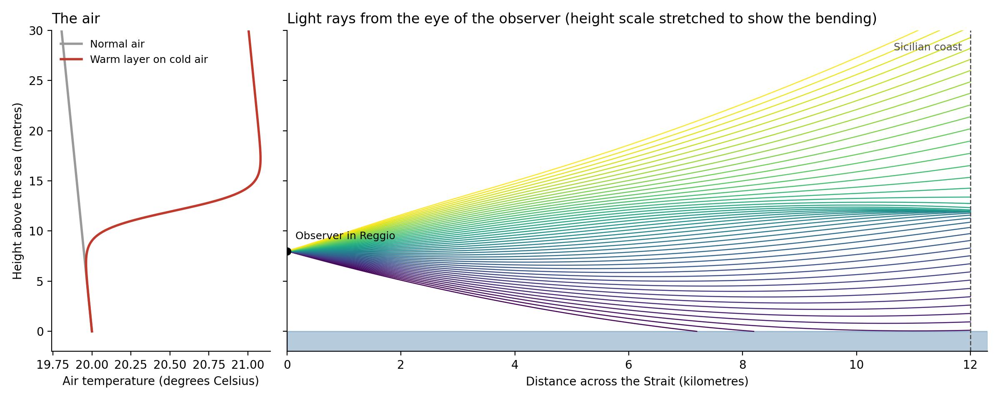
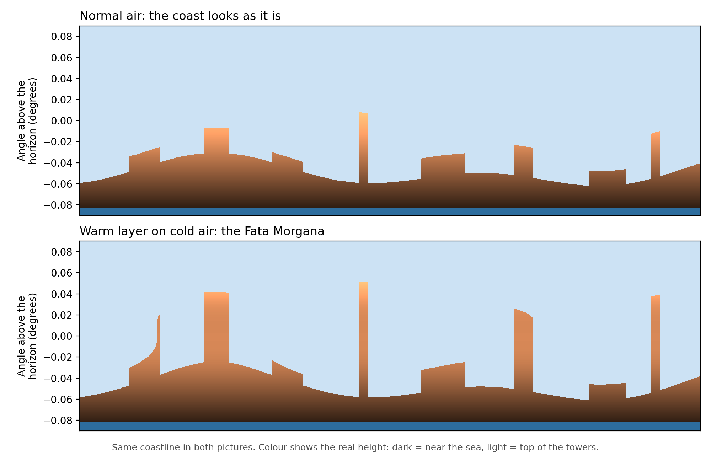
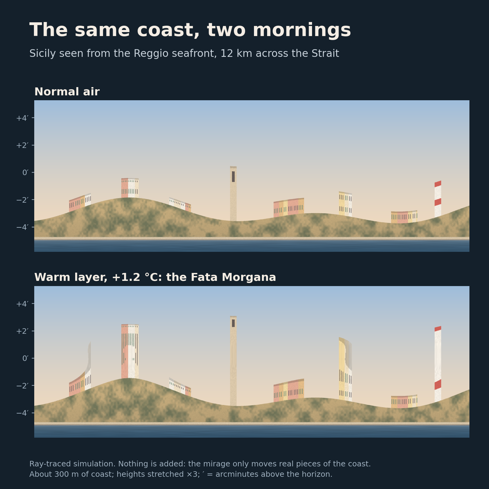
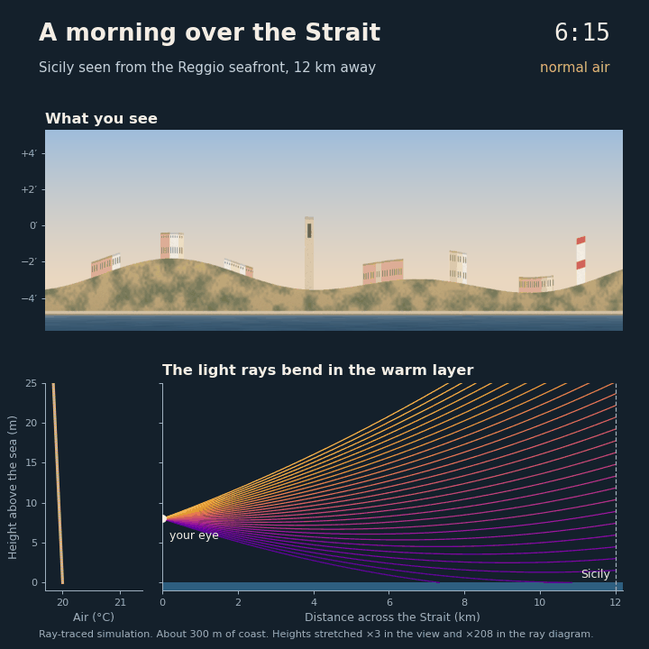

## Una città nel cielo

Estate, mattina presto, il lungomare di Reggio Calabria. Il mare è piatto come vetro. Gli anziani sono già alla ringhiera. Dall'altra parte dell'acqua, la Sicilia comincia a muoversi. La costa si stacca dal mare. Le case si allungano e diventano torri. Una città bianca sta sospesa nell'aria, così vicina che sembra di poterla toccare. Nessuno grida. A Reggio l'hanno vista tante volte. Guardano e basta. Pochi minuti dopo l'aria si muove, e la città non c'è più. Qui la chiamano Fata Morgana, e Reggio a volte viene chiamata la Città della Fata Morgana. Sono cresciuto con questa storia. In questo articolo voglio raccontarvi da dove viene il nome, cosa succede davvero nell'aria, e perché, molti anni dopo, ho ritrovato lo stesso miraggio dentro l'intelligenza artificiale.

## La fata e il re

Nell'XI secolo i Normanni portarono nel Sud Italia le storie di re Artù. Con loro arrivò anche la sua sorella maga, Morgan le Fay. Qui diventò la Fata Morgana. La leggenda ha molte versioni. In una di queste, un re straniero arriva a Reggio e vede la Sicilia all'orizzonte. La vuole raggiungere, ma non ha una barca. Appare la fata e fa sembrare l'isola a pochi passi. Il re entra in acqua per raggiungerla a piedi. E il mare se lo prende. Non è morto perché l'isola sembrava strana. È morto perché sembrava vicina, vera, ed esattamente come la desiderava.

## La luce che si piega

La Fata Morgana non è magia. È luce che si piega.
Dopo una notte fresca, l'aria appena sopra il mare resta fredda. Il sole scalda l'aria più in alto. Ora c'è aria calda sopra aria fredda, e la mattina è così calma che i due strati non si mescolano.
Nell'aria fredda la luce viaggia un po' più lentamente. Così la luce che arriva dalla costa siciliana non va dritta. Si curva. I nostri occhi non lo sanno. Mettono l'immagine nel posto sbagliato: più in alto, più alta, allungata.
Nel 1773 un frate calabrese, Antonio Minasi, la osservò più e più volte da queste coste. Dimostrò che i palazzi sospesi erano edifici veri e costa vera, spostati nel punto sbagliato del cielo.
Niente è inventato. Pezzi veri, messi insieme nel modo sbagliato, e il risultato è del tutto credibile.

## Il miraggio sul mio computer

Volevo rivederla, così ho scritto un breve programma in Python che ricrea la Fata Morgana. Usa solo NumPy e Matplotlib e gira su qualsiasi portatile in pochi secondi.
Siete sul lungomare, con gli occhi a 8 metri sopra il mare, e guardate una costa a 12 chilometri di distanza. Il programma:

1. **Descrive l'aria.** In una mattina di Fata Morgana, l'aria diventa circa 1,2 gradi più calda in uno strato sottile intorno ai 12 metri sopra il mare.
2. **Segue la luce.** Manda centinaia di raggi dall'occhio verso la costa. A ogni passo, ogni raggio si piega un po' verso l'aria più fredda. La Terra è rotonda, e il programma ne tiene conto.
3. **Disegna l'immagine.** Per ogni raggio, controlla dove arriva: mare, costa o cielo.

A sinistra nella prima figura, la linea rossa è lo strato caldo. A destra si vede che molti raggi, partiti dall'occhio con angoli diversi, arrivano quasi nello stesso punto della costa lontana. Tutto il segreto è qui: tante direzioni dello sguardo vedono lo stesso piccolo pezzo di costa.

<figure>
  
  <figcaption>Temperatura dell'aria e percorsi dei raggi di luce attraverso lo Stretto.</figcaption>
</figure>

La seconda figura mostra la stessa costa vista attraverso l'aria normale e attraverso lo strato caldo. Il colore indica l'altezza reale di ogni pezzo.

<figure>
  
  <figcaption>La stessa costa vista con aria normale e con la Fata Morgana.</figcaption>
</figure>

Con lo strato caldo, le case si alzano e diventano alte mura. Nelle mattine più forti, alcune forme appaiono due volte, una delle quali capovolta. Non è stato aggiunto niente. Il programma ha solo spostato pezzi veri della costa, proprio come aveva descritto Minasi.
Poi ho dipinto un piccolo paese sul mare, con case, un campanile e un faro, e l'ho fatto passare attraverso gli stessi raggi. Niente, nella seconda immagine, è stato disegnato a mano.

<figure>
  
  <figcaption>La stessa costa dipinta in una mattina normale e in una mattina di Fata Morgana.</figcaption>
</figure>

Ed ecco una mattina intera: lo strato caldo cresce, la costa si alza, poi l'aria si mescola e la città svanisce.

<figure>
  
  <figcaption>Una mattina sullo Stretto: lo strato caldo cresce, la costa si alza, poi il miraggio svanisce.</figcaption>
</figure>

I numeri sono scelti per rendere l'effetto facile da vedere. Le mattine vere non sono mai perfettamente calme, e infatti il miraggio vero tremola. Ma il punto resta: basta circa un grado di differenza nell'aria per mettere una città nel cielo.

Il codice è qui: [github.com/Smantii/calabria-meets-ai](https://github.com/Smantii/calabria-meets-ai/tree/master/fata_morgana).

## La fata dentro la macchina

Anche l'intelligenza artificiale ha la sua Fata Morgana. La chiamano "allucinazione". Fai una domanda a un chatbot e ti dà una risposta chiara e sicura. Cita un libro che non esiste. Riporta un numero che nessuno ha mai misurato. Sembra giusta, ed è proprio questo il problema. Un modello linguistico impara, da un'enorme quantità di testo, quali parole di solito vengono dopo quali altre. Quando risponde, costruisce la frase più probabile, pezzo dopo pezzo. Ma non ha un modo diretto per verificare se la frase è vera. Sa solo che somiglia a una frase vera.

Così un'allucinazione è fatta come il miraggio:

- È costruita con pezzi veri.
- I pezzi sono messi insieme nel modo sbagliato.
- Il risultato sembra credibile, spesso più della verità.

## Sei domande sulla mia città

Ho fatto sei domande sulla Fata Morgana a due piccoli chatbot, e ho controllato ogni risposta con le fonti originali. I modelli sono Gemma 3 (4 miliardi di parametri, di Google) e Llama 3.2 (3 miliardi di parametri, di Meta). Girano su un normale portatile senza internet, quindi tutto quello che dicono viene dal loro addestramento. Ogni domanda è stata fatta in una chat nuova, con un limite di tre frasi. Per nomi e date ho chiesto anche: "Puoi darmi la fonte, con il numero di pagina?" Le domande e le risposte erano in inglese; qui ne riporto due, tradotte.

**Chi scrisse la prima descrizione scientifica?** Antonio Minasi, nel 1773. Gemma ha risposto con assoluta sicurezza:

> Giovanni Bohler, un astronomo svizzero, pubblicò la prima descrizione scientifica dettagliata della Fata Morgana nello Stretto di Messina nel 1858. Le sue osservazioni, fatte a bordo della nave *Maria Rosa*, documentarono meticolosamente l'aspetto e il comportamento del fenomeno.

Un nome, una nazionalità, un anno, una nave. Quando ho chiesto la fonte, mi ha dato un titolo in tedesco, un editore e "pagine 151-155 della prima edizione". Non ho trovato niente di tutto questo.

**La trappola.** Cosa dissero Minasi e Goethe quando guardarono insieme la Fata Morgana? Per quanto ne sappiamo, non lo fecero mai. Llama ha detto di non avere informazioni, ed è la risposta giusta. Gemma ha scritto:

> Antonio Minasi e Goethe esclamarono, come è noto, "Che cosa meravigliosa!" assistendo al fenomeno della Fata Morgana nel 1786. [...] Resta un aneddoto celebre, che illustra il potere della meraviglia e dell'osservazione condivise.

Nel 1786 Goethe era appena arrivato in Italia. In Sicilia arrivò la primavera successiva. L'aneddoto non è celebre da nessuna parte, perché non è mai successo.

**Due modi di sbagliare.** Gemma non ha quasi mai detto "non lo so", e più la domanda era precisa, più precisa era l'invenzione. Llama ha risposto "non lo trovo" a tutte le domande su Minasi. È onesto, ma non è conoscenza, e ha comunque inventato un re e un esploratore quando la domanda sembrava una storia. Ogni risposta sbagliata era fatta di pezzi veri: la forma di una vera citazione bibliografica, un anno vero, un vero poeta che in Sicilia ci andò davvero. Messi insieme nel modo sbagliato, proprio come la costa sopra lo Stretto. Per onestà, questi sono modelli piccoli, e chatbot più grandi risponderebbero bene ad alcune di queste domande. Le risposte cambiano anche ogni volta. E ho scelto apposta dettagli antichi e locali, perché online sono rari. Il miraggio appare dove l'immagine vera è lontana.

## Di nuovo sul lungomare

Gli anziani alla ringhiera non si emozionano mai quando la città si alza sopra lo Stretto. L'hanno vista troppe volte. Se la godono, e sanno che non c'è. È così che voglio usare queste macchine. Godermi quello che sanno fare, e ricordare che una risposta bella non è sempre una risposta vera. Il re credette a quello che vedeva. La gente di Reggio guarda, e aspetta che l'aria si muova.

Nel prossimo articolo di questa serie prenderò un'altra tradizione di Reggio Calabria e la guarderò con gli occhi dell'intelligenza artificiale.

## Fonti

- [Fata Morgana mirages, di Andrew Young, San Diego State University](https://aty.sdsu.edu/mirages/FM/FM.html)
- [The Fata Morgana, Elusive Phenomenon in the Strait of Messina, Calabria: The Other Italy](https://www.calabriatheotheritaly.com/fata-morgana-strait-of-messina/)
- [Antonio Minasi, Dissertazione prima sopra un fenomeno volgarmente detto Fata Morgana, Roma 1773 (copia digitalizzata)](https://www.deutsche-digitale-bibliothek.de/item/3M5XTPRKXYQ44BHRTKA5IPFYRPWSISK4)
- [Voce "Fata Morgana", Encyclopaedia Britannica, edizione del 1860](https://jimclifford.ca/early_encyclopedia_britannica/articles/1860/eb_8th_1860_007742.html)
